  

  <b>10+ years designing, building and shipping enterprise systems end to end.</b> 
  Buenos Aires, Argentina · working remotely with distributed teams

  
  
  

  

---

## 🧭 What I do

I sit between architecture and implementation: I define the system, then stay close enough to the code to make it real.

- 🏗️ **Architecture** – scalable microservices and full-stack platforms for Fortune-level clients, from API design to production.
- 👥 **Technical leadership** – leading distributed, cross-timezone teams (8–15 people), mentoring seniors, setting standards.
- ☁️ **Cloud &amp; DevOps** – AWS, Azure and GCP; CI/CD, IaC, observability, CDN, anti-DDoS and server hardening.
- 🤖 **AI in production** – LLM integration, agents and tooling (AWS Bedrock, Ollama, prompt engineering).
- ⚙️ **Systems &amp; reverse engineering** – C/C++, native tooling, binary analysis, game and network engineering.

## 🛠️ Tech stack

**Frontend**  
     

**Backend &amp; systems**  
      

**Cloud &amp; DevOps**  
      

**Data**  
    

## 🚀 Featured work

| Project | What it is |
| --- | --- |
| [**dbo-assets-studio**](https://github.com/nbuzzi/dbo-assets-studio) | Open source desktop + CLI tool (C# / .NET 8 / WebView2) to browse and edit game PAK archives, RDF tables and WPS/TQS scripts. Prebuilt [releases](https://github.com/nbuzzi/dbo-assets-studio/releases) available. |
| [**ailang**](https://github.com/nbuzzi/ailang) | An AI-oriented language for agents, written in Rust. |
| [**AutoCoder AI**](https://marketplace.visualstudio.com/items?itemName=ClaudioNicolasBuzzi.autocoder-ai) | VS Code extension for AI-assisted coding, with local models through Ollama. |
| [**ChatNPC**](https://marketplace.visualstudio.com/items?itemName=ClaudioNicolasBuzzi.chatnpc) | VS Code extension: a conversational AI assistant inside the editor. |

Most of my professional and game-infrastructure work lives in private repositories.

## 💼 Experience highlights

- **Allata** – Full Stack Lead &amp; Software Architect (2024 – present). Enterprise solutions for Fortune 20 clients: React / Next.js / .NET Core, AWS &amp; Azure, AI-powered features, CI/CD.
- **Synalink** – Full Stack &amp; Technical Lead (2020 – 2023). Teams of 8–12, REST/GraphQL APIs at millions of requests per day, ~60% faster load times.
- **Southworks** – Lead Software Engineer &amp; Architect (2018 – 2020). Global Fortune 500 clients, teams of 10–15 across time zones.
- **Earlier** – Haivision, TNS Latam, Lagash, Softtek, Capgemini: streaming platforms, enterprise architecture, government systems, automotive integrations.

## 🎯 Currently

- Building developer tooling around AI agents and local LLMs.
- Open-sourcing the tools I built for my own projects.
- Exploring Rust for systems and language tooling.

## 🐍 Contributions

  <picture>
    <source media="(prefers-color-scheme: dark)" srcset="https://raw.githubusercontent.com/nbuzzi/nbuzzi/output/snake-dark.svg">
    
  </picture>

  
  
  

Thanks for stopping by ✌️

